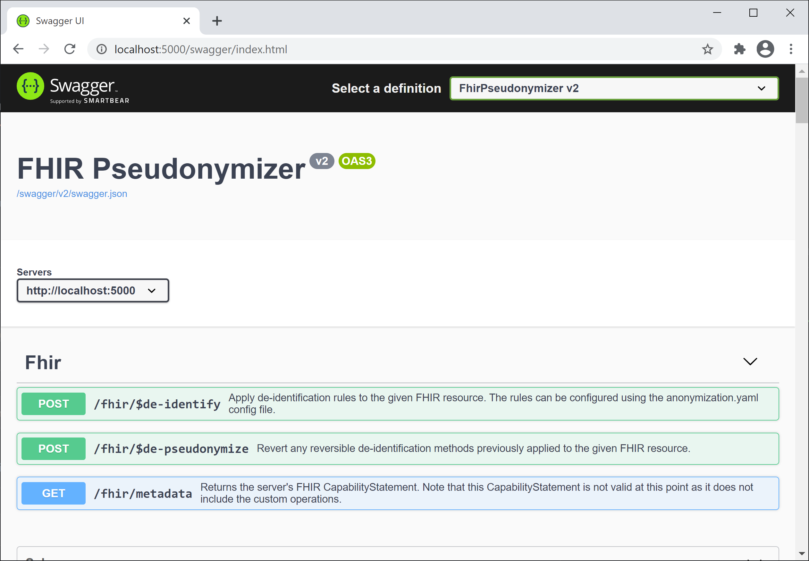

# Getting started

## Run it

This example
passes a minimal de-identification config inline that hashes every `Resource.id` with a crypto-hash and redacts
`Patient.birthDate`:

<!-- x-release-please-start-version -->

```sh
docker run --rm -i -p 8080:8080 \
  -e AnonymizationEngineConfigInline='
fhirVersion: R4
fhirPathRules:
  - path: Resource.id
    method: cryptoHash
  - path: Patient.birthDate
    method: redact
parameters:
  cryptoHashKey: "a-secret-key-with-at-least-32-characters"
' \
  ghcr.io/miracum/fhir-pseudonymizer:v3.0.0
```

<!-- x-release-please-end-version -->

In a second terminal, send it a sample Patient:

```sh
curl -X POST -H "Content-Type:application/fhir+json" \
  "http://localhost:8080/fhir/\$de-identify" \
  -d '{"resourceType": "Patient", "id": "example", "birthDate": "1985-10-14", "gender": "female"}'
```

The response contains the Patient with a hashed `id` and without a `birthDate`. To use your own
rules from a file instead, mount it into the container and set `AnonymizationEngineConfigPath` -
see [De-identification](de-identify.md).

The OpenAPI definition of the FHIR operation endpoints is served at
<http://localhost:8080/swagger/>:



## Docker Compose

The [compose folder](https://github.com/miracum/fhir-pseudonymizer/tree/master/compose) contains a
stack that uses an example anonymization config based on the
[HIPAA Safe Harbor rules](https://github.com/miracum/fhir-pseudonymizer/blob/master/compose/anonymization-hipaa.yaml):

```sh
docker compose up
# or
nerdctl compose up
# or
podman-compose up
```

Open <http://localhost:8080/swagger>, or POST any FHIR resource to
`http://localhost:8080/fhir/$de-identify`.

## Kubernetes

The recommended deployment is on Kubernetes. Use the
[Helm chart](https://github.com/miracum/fhir-pseudonymizer/tree/master/charts/fhir-pseudonymizer).

## Next steps

- Write rules for your data: [De-identification](de-identify.md).
- Create reversible, consistent pseudonyms: pick a [pseudonymization service](pseudonymization/vfps.md).
- Set keys and other options: [Configuration reference](configuration.md).
- Process messages from [Kafka](kafka.md) instead of HTTP requests.
